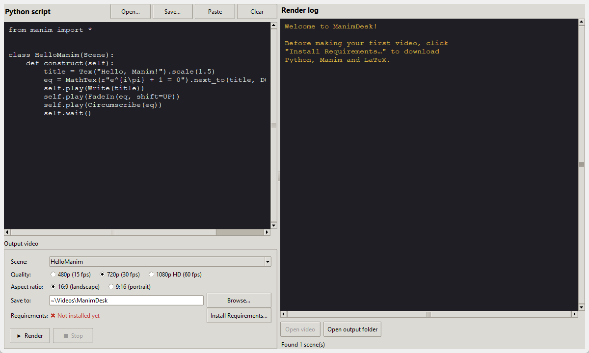
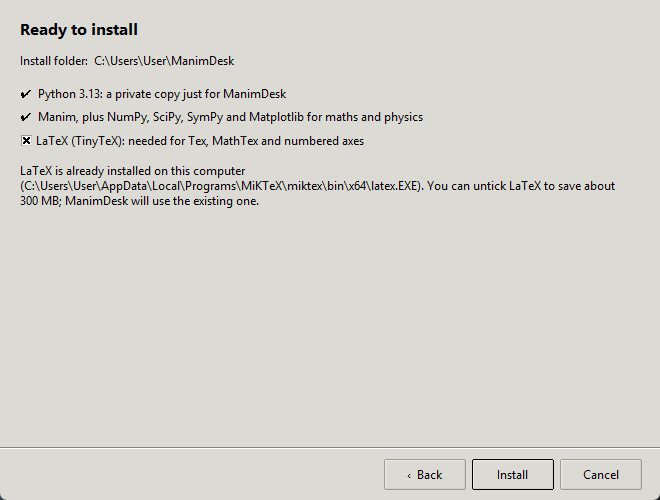

# ManimDesk

A simple desktop app for turning [Manim](https://www.manim.community/) scripts into videos.
Paste a script, pick the quality and aspect ratio, and click **Render**. No command line needed.

Works on **Windows, macOS and Linux**.



## Features

- **Script editor:** paste, open or save Manim scripts.
- **Scene picker:** finds every `Scene` class in your script automatically, with an option to render them all.
- **Quality:** 480p (15 fps), 720p (30 fps) or 1080p HD (60 fps).
- **Aspect ratio:** 16:9 landscape for YouTube, or 9:16 portrait for Shorts, Reels and TikTok.
- **One-click setup:** **Install Requirements…** downloads Python, Manim and LaTeX into a folder you choose.
- **Live render log** with errors highlighted, plus one-click buttons to open the video or its folder.

## Install

You need **Python 3.11 or newer** ([python.org](https://www.python.org/downloads/)) to run the app itself.

With [uv](https://docs.astral.sh/uv/) (recommended):

```bash
uv tool install git+https://github.com/gangulmissaka/ManimDesk
```

Or with pip:

```bash
pip install git+https://github.com/gangulmissaka/ManimDesk
```

Then start it:

```bash
manimdesk
```

or `python -m manimdesk`.

## First run: Install Requirements

Click **Install Requirements…**, choose a folder, click **Next**, then **Install**. ManimDesk downloads and sets up:

| Component | What it's for |
|---|---|
| **Python 3.13** | A private copy just for ManimDesk, so your own Python is never touched |
| **Manim, NumPy, SciPy, SymPy, Matplotlib** | Animation, maths and physics |
| **LaTeX** ([TinyTeX](https://yihui.org/tinytex/)) | `Tex`, `MathTex` and numbered axes. Optional if you already have LaTeX |

It needs an internet connection and about 1 GB of space. ManimDesk remembers the folder and uses it for every
render. To uninstall the requirements, delete the folder. Running the installer again repairs it, keeping
anything that's already installed.



### Extra step on macOS and Linux

On macOS and Linux, Manim's graphics libraries are compiled during the install, which needs a few system
packages. The installer checks for them and, if any are missing, shows the command to run, for example:

- **macOS** (with [Homebrew](https://brew.sh)): `brew install pkg-config cairo pango`
- **Ubuntu / Debian:** `sudo apt install build-essential pkg-config libcairo2-dev libpango1.0-dev`
- **Fedora:** `sudo dnf install gcc pkgconf-pkg-config cairo-devel pango-devel perl`

Linux also needs Tk for the app window: `sudo apt install python3-tk` (or your distribution's equivalent).

## Where things are saved

- **Videos:** your Videos folder (Movies on macOS), under `ManimDesk`, for example
  `~/Videos/ManimDesk/1080p60-landscape/HelloManim.mp4`. Change it with **Browse…** next to *Save to*.
- **Requirements:** the folder you chose in the installer (default `~/ManimDesk`):

```
~/ManimDesk/
├── python/       private Python
├── venv/         Manim and the maths/science packages
├── tinytex/      LaTeX
├── scripts/      the last script you rendered
├── cache/        Manim's temporary files (safe to delete)
└── manim.cfg     optional: your own Manim settings
```

To change Manim's defaults, such as the background colour, create `manim.cfg` in that folder:

```ini
[CLI]
background_color = #0f0f14
```

ManimDesk's own quality, aspect-ratio and folder settings always take priority.

## Portrait (9:16) videos

In portrait mode the scene is **8 units wide and about 14.2 units tall**, instead of Manim's usual
14.2 × 8. A scene designed for landscape will still fit across the screen, with extra room above and below.
`to_edge(UP)` and `to_edge(DOWN)` place things at the real top and bottom of the portrait frame.

## Examples

The [`examples/`](examples) folder has ready-to-render scenes. Open one with **Open…** in the app:

- `maths.py`: Pythagorean theorem, a sine wave changing frequency, a rotating 3D surface
- `physics.py`: projectile motion, a swinging pendulum

## Already have Manim?

If Manim is installed in the same Python as ManimDesk (`pip install "manimdesk[manim]"`), the app uses it
directly and you can skip **Install Requirements**.

## Development

```bash
git clone https://github.com/gangulmissaka/ManimDesk
cd ManimDesk
uv sync          # creates .venv with ManimDesk and pytest
uv run manimdesk # run the app
uv run pytest    # run the tests
```

## License

Copyright 2026 gangulmissaka.

Licensed under the [Apache License, Version 2.0](LICENSE). See [NOTICE](NOTICE).

ManimDesk is an independent project and is not affiliated with the Manim Community. Manim (MIT License)
and TinyTeX are downloaded separately under their own licenses.
